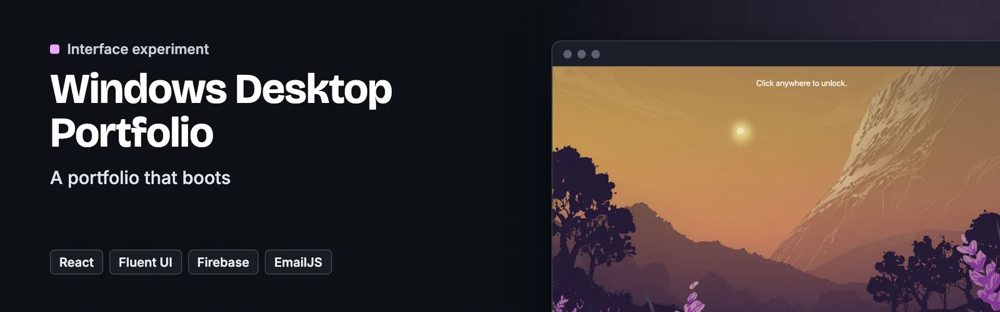
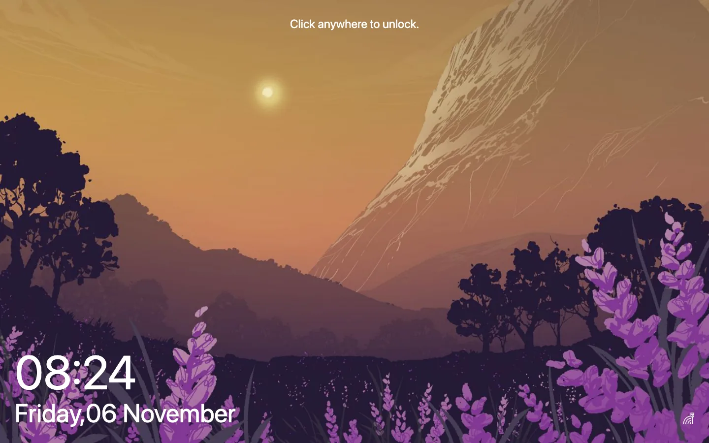
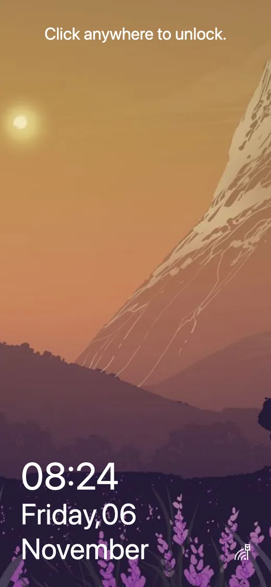

<p align="center">
  <a href="https://windows.dawidolko.pl/"></a>
</p>

# Windows Desktop Portfolio

> 🪟 **A portfolio that boots** — a Windows 10 desktop rebuilt in React, with draggable windows, a start menu and real apps inside it

**Based on [Portfolio_OS_Theme](https://github.com/srinibasbiswal/Portfolio_OS_Theme) by [Srinibas Biswal](https://github.com/srinibasbiswal), MIT licence.** Not affiliated with Microsoft; this is an interface imitation for portfolio purposes.

Instead of a page with sections, this portfolio opens as a desktop. Windows drag, resize and stack, the start menu works, the wallpaper changes, and each "application" is a part of the CV — projects, contact, notes.

Underneath it is an ordinary React single-page application; the operating system is the interface metaphor, not an emulator. Microsoft's own Fluent UI supplies the controls, which is what keeps the imitation honest.


**[Live site](https://windows.dawidolko.pl/)** · [Screenshots](#️-screenshots) · [Getting started](#-getting-started)

---

## 🎯 Key Features

- **Windows that behave like windows** — drag, focus, stack and close, with z-order handled properly rather than faked with a modal.
- **A working start menu** — applications launch from it, exactly where a Windows user reaches for them.
- **Fluent UI for the controls** — Microsoft's own design system, so buttons and dialogs match the system being imitated.
- **A rich-text note app** — Quill runs inside one of the windows, so the desktop has something to actually do.
- **A contact form without a backend** — EmailJS sends the message straight from the browser.
- **Firebase for shared state** — what needs to persist, persists.
- **Time zone aware** — moment-timezone drives the clock in the system tray.

---

## 🖼️ Screenshots

<p align="center">
  
  
</p>

---

## 🛠️ Technology Stack

| Technology | Version | Role |
| --- | --- | --- |
| **React** | 17 | The application and the window manager. |
| **Fluent UI** | 8 | Windows-native controls and theming. |
| **Quill** | 1.3 | The rich-text editor app. |
| **Firebase** | 8 | Persistence. |
| **EmailJS** | 2.6 | The contact form. |
| **moment-timezone** | 0.5 | The taskbar clock. |
| **Sass** | — | Styling beyond the Fluent theme. |

---

## 🚀 Getting Started

### Prerequisites

- Node.js 16 or newer
- npm

### 1. Clone the repository

```bash
git clone https://github.com/dawidolko/Windows-Simulaing-System-GUI.git
cd Windows-Simulaing-System-GUI
```

### 2. Install dependencies

```bash
npm install
```

### 3. Run

```bash
npm start       # development server at http://localhost:3000
npm run build   # production build into build/
```

---

## 📁 Project Structure

```
Windows-Simulaing-System-GUI/
├── public/              # index.html, icons, wallpapers
└── src/
    ├── App.js           # the desktop shell
    ├── containers/      # window manager, start menu, taskbar
    ├── components/      # the individual applications
    ├── assets/          # icons and wallpapers
    └── index.scss       # theme on top of Fluent
```

---

## 🖥️ The Family

This is one of four desktop-simulator portfolios, each built on a different stack:

| Desktop | Stack | Live |
| ------- | ----- | ---- |
| Windows 10 | React + Fluent UI | [windows.dawidolko.pl](https://windows.dawidolko.pl) |
| Ubuntu 20.04 | Next.js + Tailwind CSS | [ubuntu.dawidolko.pl](https://ubuntu.dawidolko.pl) |
| macOS | React + TypeScript + Vite | [macos.dawidolko.pl](https://macos.dawidolko.pl) |
| Deepin Linux | Vue 2 + Vuetify | [linux.dawidolko.pl](https://linux.dawidolko.pl) |

---

## ♿ Accessibility

An accessibility panel in the corner of every page changes text size, contrast, font and motion, and remembers the choice on the device. It sits on top of the markup and does not replace accessible markup.

---

## 📄 License

MIT. Copyright (c) 2020 [Srinibas Biswal](https://github.com/srinibasbiswal) and Copyright (c) 2024 [Dawid Olko](https://dawidolko.pl), see [LICENSE](LICENSE). Icons and images keep their own terms, listed in [CREDITS.md](CREDITS.md).

---

## 👨‍💻 Author

**Dawid Olko** · Fullstack / AI Developer

[Portfolio](https://olkodawid.dawidolko.pl) · [CV](https://cv.dawidolko.pl) · [LinkedIn](https://www.linkedin.com/in/dawidolko/) · [GitHub](https://github.com/dawidolko)
